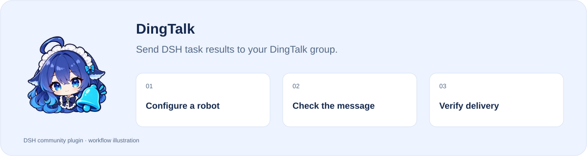

[简体中文](README.md) · **English**

# DingTalk

**Send DSH task results straight to your DingTalk group.**

DingTalk custom webhook notification plugin for DeepSeek Harness (`>=0.2.2-rc.3`): sends plain-text and Markdown messages with native live Settings forms, secret masking, HMAC-SHA256 signing, and offline health checks.

[](https://www.npmjs.com/package/dsh-dingtalk) [](https://www.npmjs.com/package/dsh-dingtalk) [](https://www.npmjs.com/package/dsh-dingtalk)

**[Install](#install) · [Get Started in 3 Steps](#get-started-in-3-steps) · [Full Guide](https://github.com/STARDUSTLC666/dsh-dingtalk/blob/main/docs/USAGE.en.md)**

<picture>
  <source media="(prefers-color-scheme: dark) and (max-width: 640px)" srcset="https://raw.githubusercontent.com/STARDUSTLC666/dsh-dingtalk/main/docs/assets/intro/workflow-en-mobile-dark.svg">
  <source media="(max-width: 640px)" srcset="https://raw.githubusercontent.com/STARDUSTLC666/dsh-dingtalk/main/docs/assets/intro/workflow-en-mobile-light.svg">
  <source media="(prefers-color-scheme: dark)" srcset="https://raw.githubusercontent.com/STARDUSTLC666/dsh-dingtalk/main/docs/assets/intro/workflow-en-dark.svg">
  
</picture>

## Install

Open **Plugins** in the DSH desktop app and install `dsh-dingtalk`, or use the CLI:

```bash
dsh plugin --profile desktop add dsh-dingtalk
```

For the web profile, replace `desktop` with `web`. Restart DSH once after installing. Requires DSH `>=0.2.2-rc.3`.

<a id="start-using-it"></a>
## Get Started in 3 Steps

1. **Create a group webhook robot**: In your DingTalk group, open **Group Settings → Smart Group Assistant → Add Robot → Custom**, enable **Sign (加签)**, and copy the **Webhook URL** and **`SEC...` signing secret**.
2. **Fill in DSH Settings (applies live)**: Open **DSH Settings → Plugins → DingTalk (`dsh-dingtalk`)**, paste `webhook` and `secret` (credentials are masked and take effect immediately without restarting; `DSH_DINGTALK_SECRET` env var is also supported).
3. **Run a silent check, then notify**: Ask the assistant to check your DingTalk configuration locally before posting build summaries or task alerts to your group.

## Copy-Ready Prompts for Everyday Work

- **Silent first-run check (sends zero messages)**
  > Check whether my DingTalk robot configuration is ready without sending any message to the group.
- **Formatted Markdown summary after a task (review before sending)**
  > Turn the build and test results into a concise Markdown DingTalk notice. Show me the title and body first, and send only after I confirm.
- **Quick plain-text heads-up**
  > Send a plain-text DingTalk notice: Staging will be under maintenance at 22:00 tonight for 15 minutes; please pause merges.

## Quick Troubleshooting Checklist

| Symptom | Likely Cause | Fix |
| :--- | :--- | :--- |
| `dsh-dingtalk 未配置` or missing `access_token` | `webhook` is blank or truncated | Paste the full Webhook URL in **DSH Settings → Plugins → DingTalk** (applies immediately) |
| DingTalk error `310000` | Signing `secret` mismatch, or "Custom keywords" is also enabled on the robot | Verify the `SEC...` secret; if keywords are enabled on DingTalk, include the keyword in the message |
| DingTalk error `120001` | Robot `access_token` expired or was reset | Copy the refreshed Webhook URL from DingTalk group settings and save |
| Request timeout | Slow network; delivery is uncertain | **Check the DingTalk group first** before resending to avoid duplicate alerts |

## Plugin updates

Check updates at the bottom of native plugin details. Automatic checks are on by default; **automatic installation is off**. Suite-managed components update with their bundle.

## Documentation

- [Usage guide and configuration reference](https://github.com/STARDUSTLC666/dsh-dingtalk/blob/main/docs/USAGE.en.md)
- [Full reference](https://github.com/STARDUSTLC666/dsh-dingtalk/blob/main/docs/REFERENCE.en.md)
- [Release notes](https://github.com/STARDUSTLC666/dsh-dingtalk/blob/main/CHANGELOG.md)
- [Validation scope and history](https://github.com/STARDUSTLC666/dsh-dingtalk/blob/main/docs/VALIDATION.md)

## Feedback and contributions

If the plugin helps, a Star makes it easier for others to discover. Report issues in [Issues](https://github.com/STARDUSTLC666/dsh-dingtalk/issues) or open [PRs](https://github.com/STARDUSTLC666/dsh-dingtalk/pulls) (please strip credentials).

## License

[MIT](https://github.com/STARDUSTLC666/dsh-dingtalk/blob/main/LICENSE)

<a id="what-it-does"></a>
<a id="requirements-and-configuration"></a>
