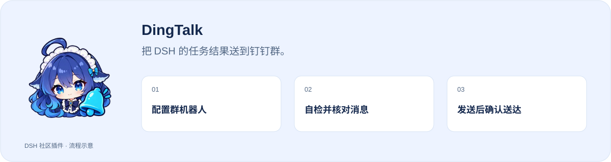

**简体中文** · [English](README.en.md)

# DingTalk

**把 DSH 的任务结果送到钉钉群。**

DeepSeek Harness（`>=0.2.2-rc.3`）钉钉群通知插件：面向自定义群机器人发送纯文本与 Markdown 消息，支持原生设置表单与热生效、HMAC-SHA256 加签校验、凭证脱敏与本地配置自检。

[](https://www.npmjs.com/package/dsh-dingtalk) [](https://www.npmjs.com/package/dsh-dingtalk) [](https://www.npmjs.com/package/dsh-dingtalk)

**[安装使用](#安装) · [最快 3 步用起来](#最快-3-步用起来) · [完整说明](https://github.com/STARDUSTLC666/dsh-dingtalk/blob/main/docs/USAGE.md)**

<picture>
  <source media="(prefers-color-scheme: dark) and (max-width: 640px)" srcset="https://raw.githubusercontent.com/STARDUSTLC666/dsh-dingtalk/main/docs/assets/intro/workflow-zh-mobile-dark.svg">
  <source media="(max-width: 640px)" srcset="https://raw.githubusercontent.com/STARDUSTLC666/dsh-dingtalk/main/docs/assets/intro/workflow-zh-mobile-light.svg">
  <source media="(prefers-color-scheme: dark)" srcset="https://raw.githubusercontent.com/STARDUSTLC666/dsh-dingtalk/main/docs/assets/intro/workflow-zh-dark.svg">
  
</picture>

## 安装

在 DSH 桌面版「插件」面板搜索安装 `dsh-dingtalk`，或使用命令行：

```bash
dsh plugin --profile desktop add dsh-dingtalk
```

网页版将 `desktop` 改为 `web`；安装后重启一次 DSH。宿主要求 `>=0.2.2-rc.3`。

<a id="开始使用"></a>
## 最快 3 步用起来

1. **建群机器人拿地址**：在目标钉钉群打开「群设置 → 智能群助手 → 添加机器人 → 自定义」，勾选「加签」，复制 **Webhook 地址**与 **SEC 加签密钥**。
2. **填进原生设置（保存即生效）**：打开 DSH「**设置 → 插件 → 钉钉（dsh-dingtalk）**」，填入 `webhook` 与 `secret`（凭据自动脱敏，保存后无需重启；也支持环境变量 `DSH_DINGTALK_SECRET`）。
3. **先自检再发正式群**：在对话里让助手先做一次无打扰本地自检，确认无误后再把构建报告、巡检结果或日报发进群。

## 平时怎么对助手说（可直接复制的自然语言示例）

- **首次自检（不发群消息、不刷屏）**
  > 帮我检查一下钉钉机器人配置有没有填好，不要往群里发消息。
- **任务跑完后发排版卡片（发送前人工过目）**
  > 把刚才构建和测试的结果整理成一条简明 Markdown 钉钉通知，先给我看一眼标题和正文，我确认后再发出。
- **快速发一句纯文本提醒**
  > 给钉钉群发一条纯文本提醒：今晚 22:00 预发布环境维护 15 分钟，请暂停合并。

## 常见卡点自检

| 遇到的现象 | 10 秒定位原因 | 怎么修 |
| :--- | :--- | :--- |
| 提示 `dsh-dingtalk 未配置` 或缺 `access_token` | 还没填 `webhook`，或复制漏了 `?access_token=...` | 打开 DSH「设置 → 插件 → 钉钉」粘贴完整 Webhook，保存立即生效 |
| 钉钉返回 `310000` | `secret` 加签密钥填错，或机器人额外勾选了「自定义关键词」 | 核对 `SEC...` 密钥；若开了关键词，正文或标题需包含该关键词 |
| 钉钉返回 `120001` | 群机器人的 `access_token` 已重置或失效 | 在钉钉群重新复制最新 Webhook 替换保存 |
| 提示请求超时 | 网络抖动，尚不确定钉钉是否已收到 | **先看一眼群消息是否已到**，确认没收到再让助手重发，避免重复刷屏 |

## 插件更新

在原生插件详情页底部检查更新。默认自动检查，**默认不自动安装**；是否安装、何时重启由你决定。Suite 管理的组件随整包更新。

## 文档

- [使用说明与参数参考](https://github.com/STARDUSTLC666/dsh-dingtalk/blob/main/docs/USAGE.md)
- [详细参考说明](https://github.com/STARDUSTLC666/dsh-dingtalk/blob/main/docs/REFERENCE.zh.md)
- [更新记录](https://github.com/STARDUSTLC666/dsh-dingtalk/blob/main/CHANGELOG.md)
- [验证范围与历史](https://github.com/STARDUSTLC666/dsh-dingtalk/blob/main/docs/VALIDATION.md)

## 反馈与贡献

如果插件帮到了你，欢迎 Star。问题和建议请提交 [Issues](https://github.com/STARDUSTLC666/dsh-dingtalk/issues)，也欢迎 [PR](https://github.com/STARDUSTLC666/dsh-dingtalk/pulls)（反馈时请移除凭据）。

## License

[MIT](https://github.com/STARDUSTLC666/dsh-dingtalk/blob/main/LICENSE)

<a id="依赖与配置"></a>
